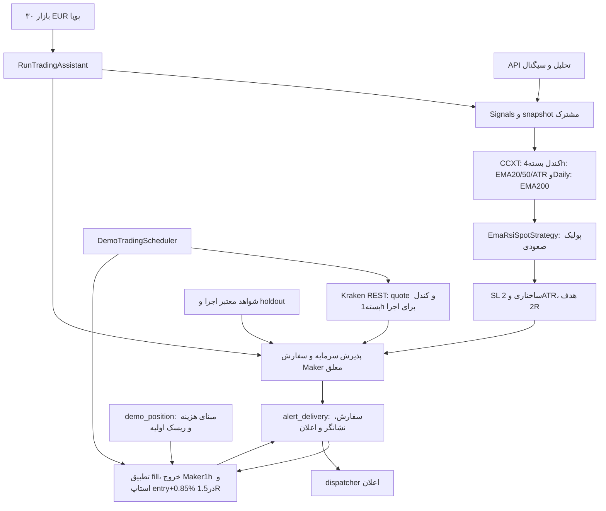

# ارتباط بخش‌های production

تمام فایل‌های production از main قابل‌دسترسی‌اند؛ تست ساختار مرز محصول و
تحقیق و نبود فایل جداافتاده/پوشهٔ خالی را کنترل می‌کند. API محصول۲۰ مسیر دارد.

دادهٔ quote برای پذیرش post-only و کندل ذخیره‌شده برای fill و خروج است؛
تصمیم ورود فقط از هستهٔ مشترک تحلیل می‌آید. هدف سفارش جدید از قیمت Limit
واقعی در۲R محاسبه و سپس با هزینه‌ها بررسی می‌شود؛ SL ساختاری حفظ می‌شود.
خرید و TP به‌صورت Maker می‌مانند؛ stop سفارش‌های جدید Market با هزینه و لغزش فرضی است.
اجرای واقعی سفارش صرافی پیاده نشده؛ این چرخهٔ دمو است.
سیگنال ورود4h می‌ماند؛ اجرای سفارش‌های جاری و خروج پوزیشن‌های جدید1h است.
`executionTimeframe` جداگانه ذخیره می‌شود؛ پوزیشن‌های قبلی با مقدار null از
تایم‌فریم خود استفاده می‌کنند. Scheduler فقط دادهٔ بازارهای دارای سفارش/پوزیشن
و ماکروی لازم سفارش‌ها را می‌گیرد؛ دریافت موفق هر بازار تا کندل بعدی cache می‌شود.

| پوشه | مسئولیت |
| --- | --- |
| assets | فهرست و metadata دارایی‌ها؛ سبد ثابت runner را تغییر نمی‌دهد |
| signals | نسخهٔ فعال، snapshot و توضیح همان تصمیم در API |
| trading/ccxt | دادهٔ زنده، اعتبارسنجی، اندیکاتورها، cache و حلقهٔ ورود |
| risk | SL از۱۰کندل/۲ATR و هدف اولیه۲R |
| trading | سیاست Maker، پذیرش هزینه، حجم و خروج/Break-even مشترک |
| demo-trading | صف پایدار، رزرو نقد، سقف پوزیشن پرشده و TTL24ساعت، پوزیشن، خروج و اعلان |
| market-data | REST، quote، ذخیره/کیفیت/ترمیم کندل‌های بسته |
| strategy-approval | خواندن شواهد؛ OHLC proxy اجازهٔ APPROVED نمی‌دهد |
| alerts/entities | قرارداد همان جدول موجود نشانگر، سفارش و outbox |

تحقیق فقط در test/research است و تولید نتیجهٔ آن در bootstrap محصول وارد
نمی‌شود. برای نقشهٔ فایل‌ها [STRUCTURE.md](STRUCTURE.md) و برای routeها
[API.md](API.md) را ببینید.

سیاست stop در snapshot سفارش و سپس `demo_position.stopExecutionPolicy` ذخیره
می‌شود؛ null قواعد Maker قبلی را حفظ می‌کند. موتور اجرا برای stop گپ و لغزش
را لحاظ می‌کند و در پایان کندل ساعتی نتیجه می‌دهد؛ سفارش واقعی ارسال نمی‌شود.
